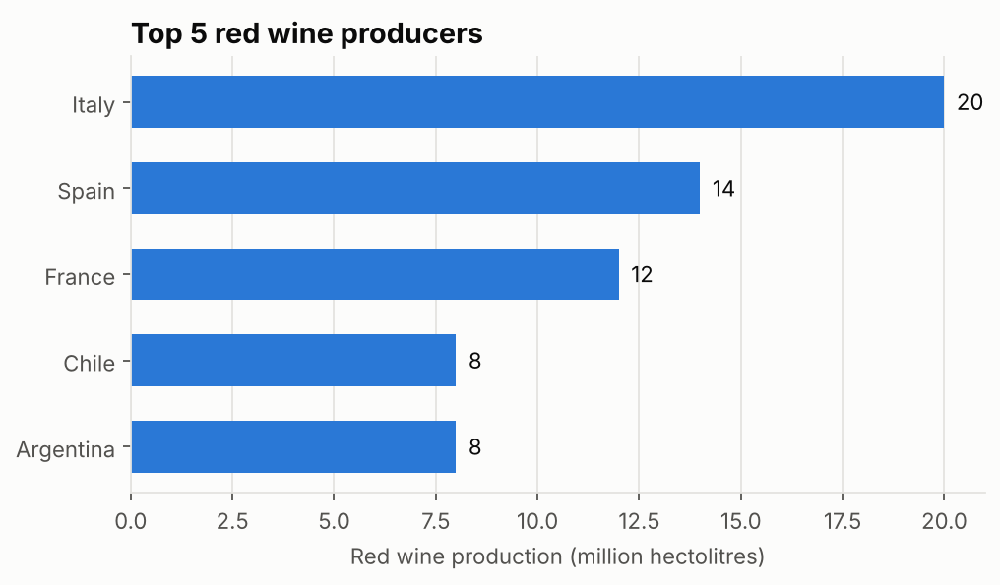
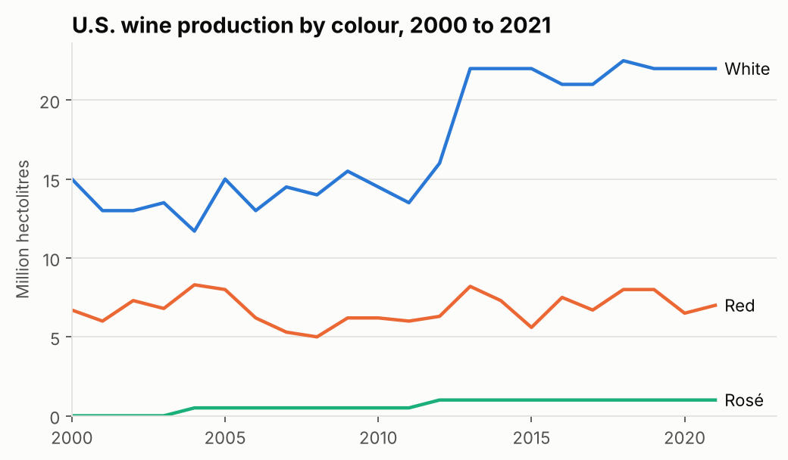
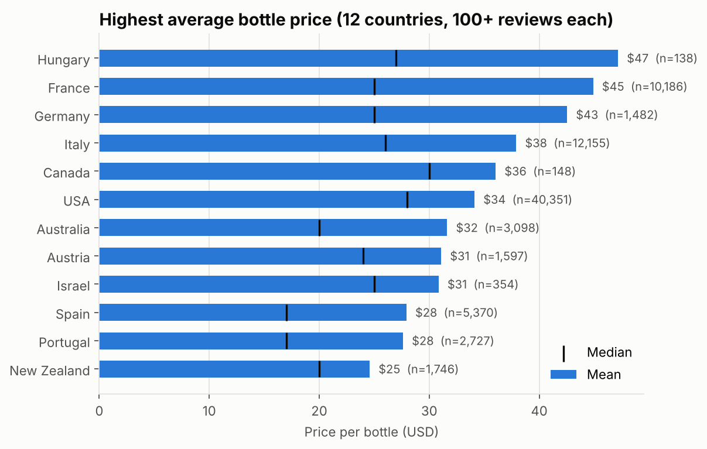
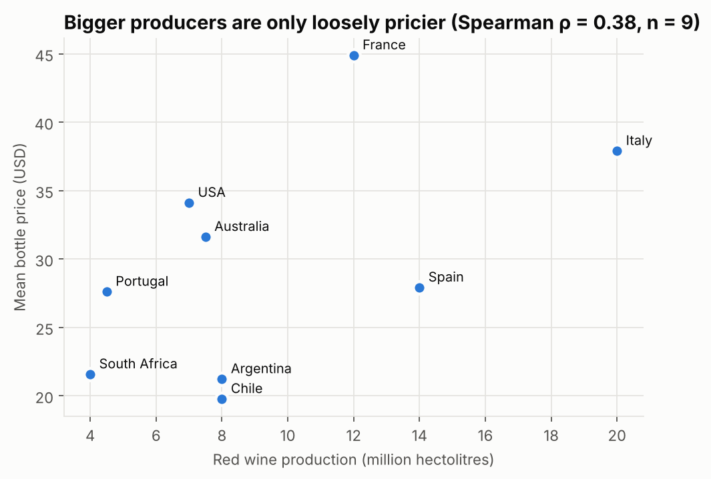

# Where Wine Is Made and What It Sells For

A Python rebuild of my [Tableau Public dashboard](https://public.tableau.com/views/Book3_17731179270700/Dashboard1). It joins OIV production data with ~89,000 de-duplicated Wine Enthusiast reviews to answer three questions for a new investor in the wine industry:

1. Where does the world's wine come from?
2. How is U.S. production changing?
3. Which countries charge the most, and are they the same countries that produce the most?

**Finding:** volume and price are only loosely related. Across the nine countries in both datasets, production rank and average price rank have a Spearman correlation of 0.38 (p = 0.32, so not significant at this sample size). Chile and Argentina are the 4th largest red producers but have the two lowest average prices. The U.S. is 7th by volume but 3rd by price.

## Results

### 1. Where wine is made



Italy, Spain and France produce just over half of the top-ten red volume. Over the last two decades France's share of world red production fell by 8 points (21.9% to 13.9%), while Chile, Spain and Argentina each gained 1.6 to 2.4 points (`outputs/tables/red_share_shift.csv`).

### 2. U.S. production by colour



| Colour | 2000 (mHL) | 2021 (mHL) | Annual growth |
|---|---|---|---|
| White | 15.0 | 22.0 | 1.8% |
| Red | 6.7 | 7.0 | 0.2% |
| Rosé | 0.5 (2004) | 1.0 | 4.2% from 2004 |

Rosé is zero until 2004, so its growth rate is measured from its first non-zero year. White's share of U.S. production rose from 69% to 73%.

### 3. What each country charges



Bars show the mean, and the black tick shows the median. Only countries with at least 100 priced reviews are ranked, because below that a few luxury bottles decide the order. Hungary has the highest mean ($47), but its median is $27 and its 95% confidence interval runs from $34 to $61. Two Tokaji Essencia bottles, at $544 and $764, account for much of the gap between mean and median. France ($45) is the highest-priced country with a large sample.



## How it works

```
src/wine_analysis/
  load.py       read the OIV workbook and the reviews, drop duplicate reviews, align country names
  analysis.py   top producers, share shift, U.S. growth (CAGR), price by country with CIs, rank comparison
  charts.py     matplotlib charts with a fixed colour order and direct labels
  __main__.py   run everything, write outputs/
tests/          unit tests on small hand-built fixtures
```

Methods:
- **De-duplication.** 53,079 of the 150,930 rows are exact duplicates. Leaving them in would over-weight the countries that were scraped more often.
- **Minimum sample.** A country needs at least 100 priced reviews to be ranked on price.
- **Mean and median.** Bottle prices are right-skewed, so both are reported, with a 95% CI on the mean (mean ± 1.96 standard errors).
- **Rank comparison.** Spearman correlation between production volume and mean price across the countries present in both sources.

## Run it

```bash
python -m venv .venv && source .venv/bin/activate
pip install -e ".[dev]"
# put winemag-data_first150k.csv in data/raw/ (see data/README.md)
python -m wine_analysis      # writes outputs/tables, outputs/figures, outputs/summary.json
pytest                       # 5 tests
```

## Limitations

- Review prices are U.S. retail prices for wines that Wine Enthusiast chose to review. They are not export prices, and they are not a random sample of each country's wine.
- The OIV red production table is a single snapshot and the share table uses multi-year periods, so the two don't line up year by year.
- The reviews date from 2017 and the U.S. production series ends in 2021.

**Tools:** Python, pandas, matplotlib, pytest. The original dashboard was built in Tableau.
